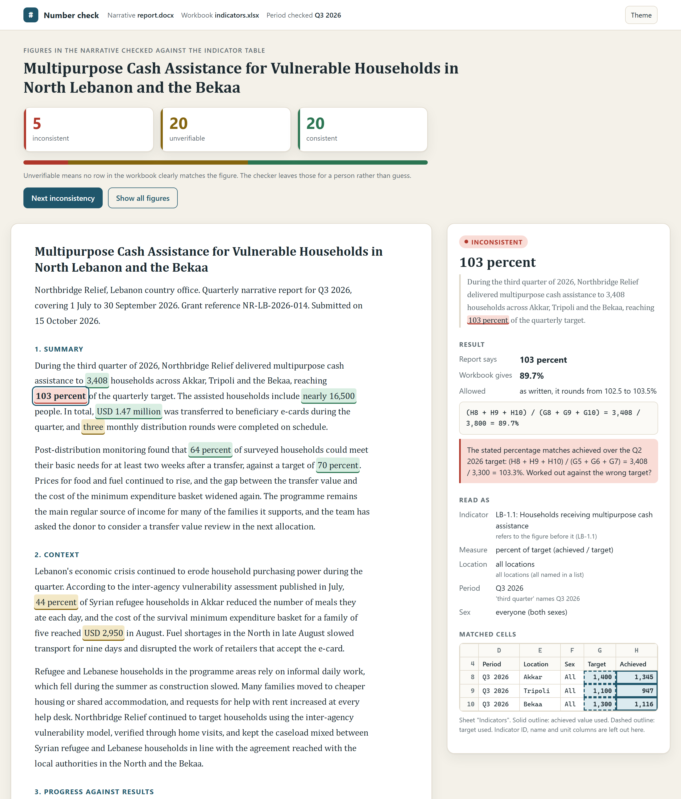

# report-number-check

Finds the figures in a narrative donor report that disagree with the indicator spreadsheet behind it.



<sub>More screenshots: [phone](docs/review-mobile.png), [dark theme](docs/review-dark.png). All data shown is synthetic; Northbridge Relief is a fictional organisation.</sub>

## The need

A quarterly donor report is written in Word by one person from an indicator spreadsheet kept by another.
Last quarter's figure is left in a paragraph, two digits are swapped, a percentage is worked out against
the wrong target. Donors notice. Checking every number by hand against the spreadsheet takes hours and is
the first thing skipped at deadline.

## Try it

```
python -m venv .venv
.venv\Scripts\activate          # or: source .venv/bin/activate
pip install -e .
numcheck check data/lebanon-cash-q3-2026/report.docx data/lebanon-cash-q3-2026/indicators.xlsx --out review.html
```

(`python -m numcheck ...` does the same if your machine blocks new executables.) Real output, abridged
from [docs/sample-output.txt](docs/sample-output.txt):

```
45 figures: 5 inconsistent, 20 unverifiable, 20 consistent

INCONSISTENT  '103 percent'  workbook: 89.7%
    sentence: During the third quarter of 2026, Northbridge Relief delivered multipurpose cash assistance to 3,408 households across Akkar, Tripoli and the Bekaa, reaching 103 percent of the quarterly target.
    read as:  LB-1.1 pct_target, all locations, Q3 2026
    calc:     (H8 + H9 + H10) / (G8 + G9 + G10) = 3,408 / 3,800 = 89.7%
    hint:     The stated percentage matches achieved over the Q2 2026 target: (H8 + H9 + H10) / (G5 + G6 + G7) = 3,408 / 3,300 = 103.3%. Worked out against the wrong target?

INCONSISTENT  '974'  workbook: 947
    sentence: Akkar accounted for 1,345 households, Tripoli for 974 and the Bekaa for 1,116.
    read as:  LB-1.1 achieved, Tripoli, Q3 2026
    calc:     H9 = 947
    hint:     Two digits look swapped: the workbook says 947, the report says 974.
    note:     Sum check in the text: the locations 1,345 + 974 + 1,116 = 3,435, but the stated total is 3,408 (a gap of 27).

INCONSISTENT  '301'  workbook: 272
    sentence: Of these, 301 were closed within 14 days, the standard set in the feedback procedure (see Annex 2, page 14).
    read as:  LB-3.2 achieved, all locations, Q3 2026
    calc:     H52 + H53 + H54 = 272
    hint:     The stated figure is the Q2 2026 value (H49 + H50 + H51 = 301). Left over from an earlier report?

(two more: a women/men split that does not add up, and "more than USD 2.8 million" against 2,744,270)
review page written to review.html
```

`review.html` is one self-contained file (no external scripts or fonts) that can be emailed or attached
to a pull request. The exit code is 1 when any figure is inconsistent, 0 when none is, 2 when a file
cannot be read, so the command can gate a document repository in CI:

```yaml
- run: numcheck check reports/q3.docx reports/q3-indicators.xlsx --out review.html
```

The same page runs as a small web app, with a sample picker and an upload form:

```
numcheck serve        # http://127.0.0.1:8110
```

## How it works

There is no language model and no API key anywhere. Every result comes from fixed rules, so the same
report always gives the same answer and every answer can be traced to a rule and a cell.

| Step | What happens |
|---|---|
| Read | `.docx` paragraphs and headings (python-docx) or Markdown; the `.xlsx` indicator table is found by its header row, with loose column names (Achieved or Actual, Location or County or Department, Sex or Gender). Percent-formatted cells are read as percentages. |
| Extract | Every number in the text: `3,284`, `62%`, `62 per cent`, `USD 1.43 million`, `1.2 thousand`, spelled numbers (`forty-two staff`), fractions (`about a third of`), with the hedge in front (`nearly`, `over`, `at least`, `about`...). Dates, years, section numbers, page and annex references, phone numbers, codes, durations, ages and measurements are skipped. |
| Interpret | From the words around the number: which indicator (unit word plus keywords and synonyms), which measure (achieved, target, percent of target, share of women, a rate), which location, which period (`last quarter`, `since April`, `second quarter`) and which sex. |
| Look up | Sum the matching cells; percent of target is achieved over target; share is women over everyone. |
| Compare | With the rounding implied by how the figure is written (`1.2 thousand` covers 1,150 to 1,250) and the hedge window from the config (`nearly 3,000` allows 2,850 to 3,000, so 2,940 passes and 3,100 fails). |
| Explain | Where the stated figure is found elsewhere: last quarter's value, another location, a swapped pair of digits, another target. Sum checks inside the text (women plus men, locations against the total). |

All vocabulary lives in [numcheck/config/matching.toml](numcheck/config/matching.toml): units, synonyms
(`households` = `families`), location aliases, period phrases, hedge tolerances, and the words that mark
a plan or a subset (`will`, `plans to`, `affected`, `per household`).

**The weak-match rule.** A false "consistent" is the worst error this tool can make, so a figure is only
checked when the match is clear. The best indicator must score at least 1.0 on keywords (a word in the
sentence counts 1, a word in the previous sentence or the section heading counts 0.5) and beat the
runner-up by 0.5. A figure with no unit, an unknown unit (`36 shops`), an unclear location, a plan, a
subset, or a sex split the workbook does not have is reported as **unverifiable**, with the reason. A
test checks that `Floods damaged 800 households in the North` stays unverifiable even though 800 is
exactly the North value in the workbook.

## The data

[scripts/generate_data.py](scripts/generate_data.py) writes three synthetic quarterly reports for the
fictional Northbridge Relief, each four pages in Word (page count measured in Word), with its workbook and
a gold file that labels every number in the text:

| Report | Use | Figures in gold | Planted errors |
|---|---|---|---|
| Cash assistance, Lebanon | tuning | 45 | 5 |
| Water, sanitation and hygiene, Kenya | tuning | 43 | 5 |
| Education in emergencies, Colombia | **held out** | 32 | 6 |

Planted errors: a figure left over from the previous quarter, transposed digits, a percentage against the
wrong target, a women/men split that does not sum, a hedge that overstates, and (Colombia only) one
location's figure given for another. The Colombia report uses different phrasing and a different
workbook layout (`Code`, `Department`, `Gender`, `Planned`, `Actual`, rates stored as fractions).

How the held-out report was kept unseen: I wrote all three generators, including the Colombia text,
before writing the checker. While tuning, `scripts/benchmark.py` skips the held-out report unless
`--final` is given. I ran it once, after the rules were frozen at commit `4c79f6b`, and changed nothing
afterwards. Because I wrote its text, it is less independent than a report written by someone else.

## Results

`python scripts/benchmark.py --final` (full output in [docs/benchmark-output.txt](docs/benchmark-output.txt)):

```
== ALL HELDOUT REPORTS ==
  claims in gold                        32  (consistent 20, planted errors 6, not in workbook 6)
  planted errors caught                 5/6 (83%)
  wrong figures passed as consistent    0 planted errors, 0 claims with no workbook support
  false alarms                          1 of 20 correct figures; 0 of 6 figures not in the workbook
  correct figures confirmed             11/20 (55%)
  correct figures left unverifiable     7
  claims matched to the right cell(s)   15/26 (58%) of checkable claims (15/17 of those the tool attempted)
  figures not extracted                 1
  non-claims ignored                    21/24 (88%)
  numbers extracted that are not in gold 0

== ALL TUNING REPORTS ==
  claims in gold                        88  (consistent 45, planted errors 10, not in workbook 33)
  planted errors caught                 10/10 (100%)
  wrong figures passed as consistent    0 planted errors, 0 claims with no workbook support
  false alarms                          0 of 45 correct figures; 0 of 33 figures not in the workbook
  correct figures confirmed             45/45 (100%)
  correct figures left unverifiable     0
  claims matched to the right cell(s)   55/55 (100%) of checkable claims (55/55 of those the tool attempted)
  figures not extracted                 0
  non-claims ignored                    78/78 (100%)
  numbers extracted that are not in gold 0
```

Read the held-out numbers, not the tuning ones: the rules were adjusted until the two tuning reports were
clean, so 100% there says little. On the unseen report the checker caught 5 of 6 planted errors and passed
no wrong figure as consistent. Its main weakness is coverage: 7 of 20 correct figures were left
unverifiable, and 2 of 17 attempted figures were matched to the wrong cells (both were still flagged as
inconsistent, one correctly). The "non-claims ignored" line hides one more false alarm: the threshold
`80 per cent` inside "attended at least 80 per cent of sessions" was flagged as an inconsistent figure.

## Where it fails

Real sentences from the held-out Colombia report:

- *"Upwards of 1,050 parents and caregivers attended school committee meetings this quarter"*: the
  planted overstated hedge (the workbook has 1,022, so "upwards of 1,050" is false) was missed.
  `parents` is not in the unit vocabulary, so the figure was reported as counting an unknown unit.
  Unverifiable, not wrongly consistent, but a miss.
- *"...short of the 75 per cent benchmark agreed with the donor."*: `benchmark` is not a target word in
  the config, so 75 was compared with the achieved rate (66%) and flagged. A false alarm.
- *"Roughly two thirds of enrolled children attended at least 80 per cent of sessions"*: the `80 per cent`
  is part of the indicator definition, not a result, but was extracted as a claim.
- *"La Guajira: 1,294; Arauca: 1,007; Norte de Santander: 1,135."*: a list with no unit word anywhere in
  the sentence. All three correct figures were left unverifiable.
- *"The figure stood at 2,969 at the end of June"*: no unit, and the checker does not map a month to a
  quarter. Unverifiable.
- *"A total of 3,303 learning kits (...) were handed out, 1,110 of them in Norte de Santander."*: the total
  was matched to the Norte de Santander row instead of the sum of all three. It was flagged (correctly,
  the digits were swapped) but against the wrong cell.

## What I would add next

- Read numbers inside Word tables, not only paragraphs.
- Take unit words from the workbook itself (an indicator named "Parents and caregivers..." with unit
  "People" should teach the checker that `parents` counts people), and map months to quarters.
- A Word add-in or SharePoint flow that runs the check when a report is saved.
- An LLM could propose the indicator match for figures the rules leave unverifiable, shown to the
  reviewer as a suggestion; the rules would still decide what counts as consistent.

## Layout

```
numcheck/            the checker: numbers.py (extract), matcher.py (interpret), checks.py (compare),
                     workbook.py, narrative.py, render.py + static/review.html (page), cli.py, app.py
numcheck/config/     matching.toml: vocabulary, tolerances, weak-match thresholds
scripts/             generate_data.py, datagen/ (report templates), benchmark.py
data/                three synthetic reports: report.docx, report.md, indicators.xlsx, gold.json
tests/               pytest: number forms, hedges, non-claims, derived checks, weak-match rule, CLI, app
```

Run the tests with `pip install -e ".[dev]"` then `pytest`.

## Licence

MIT, see [LICENSE](LICENSE). All reports, workbooks and figures in this repository are synthetic.
